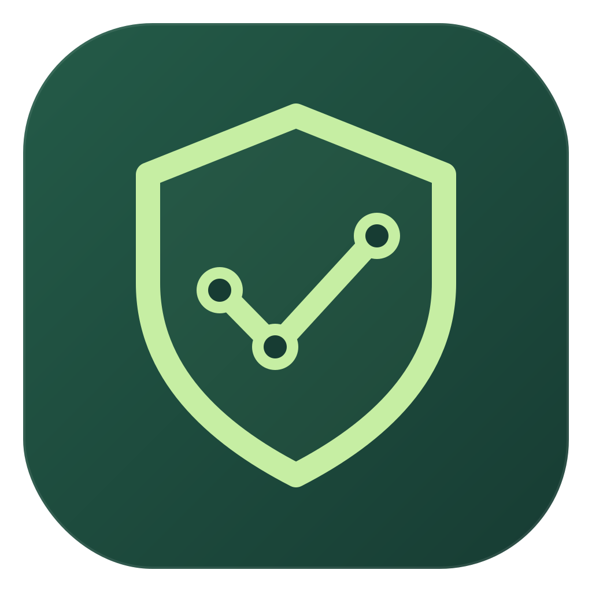
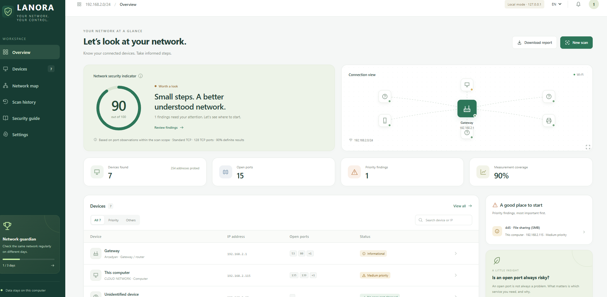

<p align="center">
  
</p>

<h1 align="center">LANORA</h1>

<p align="center">
  <b>L</b>ocal <b>A</b>rea <b>N</b>etwork <b>O</b>bservation &amp; <b>R</b>isk <b>A</b>ssessment<br>
  Know every device on your network. Understand the risk.
</p>

<p align="center">
  <a href="https://github.com/smyrna-pergamum/Lanora/releases/latest"></a>
  <a href="LICENSE"></a>
  
  <a href="https://github.com/smyrna-pergamum/Lanora/releases"></a>
</p>

<p align="center">
  <a href="https://github.com/smyrna-pergamum/Lanora/releases/latest"><b>⬇ Download for Windows</b></a>
  &nbsp;·&nbsp; <a href="#features">Features</a>
  &nbsp;·&nbsp; <a href="#quick-start">Quick start</a>
  &nbsp;·&nbsp; <a href="#privacy">Privacy</a>
</p>



LANORA is a free, open-source network scanner for home and small-office Windows users. It finds the devices on your network, checks which ports they have open and explains the risks in plain language, all on your own computer.

## Features

- **Device discovery:** ICMP, the ARP neighbor table and limited TCP evidence, with offline vendor lookup (IEEE OUI).
- **Port and service scanning:** Quick, Standard and Custom profiles, with HTTP, TLS and banner evidence for open ports.
- **Network security indicator:** a 0–100 score with every finding explained in four parts: what was observed, what it means, what to do and how to verify it.
- **Network map, scan history and comparison** to follow changes over time.
- **Advanced scan**, built in with nothing extra to install:
    - hostname and external targets (only after you confirm you are authorized)
    - native UDP service probes (DNS, NTP, SNMP, SSDP, mDNS and more)
    - traceroute, device names via reverse DNS and operating system estimates
    - safe service checks (`http-title`, TLS versions, SSH banner, anonymous FTP), detection only
- **PDF and Excel reports.**
- **English, Turkish and German** interface, reports and guide.

## Quick start

1. Download `Lanora-1.2.0-Setup-x64.exe` (installer) or `Lanora-1.2.0-Portable-x64.zip` (no installation) from the [latest release](https://github.com/smyrna-pergamum/Lanora/releases/latest).
2. Run it. The installer installs for the current user only and needs no administrator rights or .NET runtime.
3. LANORA sits in the system tray and opens its interface in your default browser. Click **New scan**.

> **Unsigned build:** the current release is not code-signed yet, so Windows SmartScreen may warn about an unknown publisher. You can check the downloads against `SHA256SUMS.txt` in the release.

**Requirements:** Windows 10 or 11, x64.

## Privacy

- The interface listens only on `127.0.0.1`. Nothing is reachable from other computers.
- No account, no cloud and no telemetry. Scan results never leave your computer.
- Data is stored in `%LOCALAPPDATA%\Lanora\`, with a retention setting and deletion of single scans or all data.

## Responsible use

Only scan networks and systems that you own or are authorized to test. The standard scan is limited to your directly connected private network. Hostnames and external targets are scanned only by the advanced scan, and only after you tick the authorization checkbox.

## Feedback and contributing

Bug reports, ideas and pull requests are welcome in [Issues](https://github.com/smyrna-pergamum/Lanora/issues). To build from source, see [Build and test](#build-and-test).

---

# Technical documentation

**Languages:** English is the primary language and the default for the interface, tray menu, reports and documentation. Turkish and German are available as secondary languages (Settings → Language, or per report).

LANORA was built to the technical specification's **MVP** scope and the "Network Security Interface" design. Version **1.1** added an **advanced scan** that needs no installation (UDP, traceroute, device names, external/hostname targets).

## Running

Run the installer or the portable `Lanora.exe` from the [latest release](https://github.com/smyrna-pergamum/Lanora/releases/latest). A local build is at `dist/Lanora-1.2.0-win-x64/Lanora.exe`. No installation and no .NET runtime are required (self-contained, win-x64).

- The application sits in the system tray and opens the interface in the default browser.
- If you close the interface, double-click the tray icon or choose **Open interface**. Reloading the page ends the session for security reasons; open it from the tray again.
- **Exit** cancels any active scan and closes the listener and the database.
- Starting it a second time does not open a new server; it shows the running instance's interface.

Data: `%LOCALAPPDATA%\Lanora\` (`lanora.db`, `logs\`, `backups\`).

## Build and test

```
dotnet test
node tests/frontend/frontend-checks.cjs
dotnet publish src/Lanora/Lanora.csproj -c Release -o dist/Lanora-1.2.0-win-x64
```

Requirements: .NET 10 SDK (Windows). Development flags: `--no-browser`, `--data-dir <folder>`, `--dev-url-file <file>` (writes the launch URL to a file; testing only).

## 1.2.0 — English as primary language

- Every translation table (interface, reports, guide/FAQ, ruleset) is now ordered **\[en, tr, de\]**. English is the default and the fallback for missing or unknown languages.
- New installations start in English. Existing installations keep the language that was saved in Settings.
- All source code comments, log and evidence texts, test descriptions and documentation are in English.

## 1.1.1 — Code audit fixes

All findings of the "Lanora code audit and test report" (2026-10-19) are fixed. Each one has a regression test in `tests/Lanora.Tests/ReviewRegressionTests.cs` or `tests/frontend/frontend-checks.cjs`.

| Code | Severity | Fix |
| --- | --- | --- |
| F01 | High | API path, Host and Origin checks are case-insensitive, so variants such as `/API/v1/...` get 401 without a token (GET/HEAD/report/event endpoints). |
| F02 | High | When an advanced scan is cancelled, fails or exceeds its budget, the devices and observations found so far are saved, including on cancel during discovery. Unmeasured ports become `not_tested`. |
| F03 | High | Comparison handles both standard and advanced snapshot schemas. Advanced snapshots store the real TCP/UDP port lists, and a second report no longer fails. |
| F04 | High | Advanced scan has a 15-minute time budget (`TIME_BUDGET_EXCEEDED` gives a partial result). Targets × ports is capped at 2,000,000 probes. |
| F05 | Medium | When no adapter can be selected, no target counts as local, so the external-target authorization gate works correctly. |
| F06 | Medium | CIDR expansion leaves out the network and broadcast addresses (except /31 and /32). |
| F07 | Medium | With a UDP-only technique, no TCP is planned for any scope. |
| F08 | Medium | "Top N ports" produces exactly N ports (priority ports first, then filled in order). Out-of-range N is rejected. |
| F09 | Medium | The operating system and service/version options are passed to the engine; when they are off, no estimate is made and no probe is sent. |
| F10 | Medium | The FTP anonymous check reads multi-line or long greetings with the line protocol. A timeout is recorded as "could not be checked". |
| F11 | Medium | The advanced summary shows the real port count and the number of probes sent. |
| F12 | Low | Wrong JSON field types return 400 instead of 500 (`SETTING_INVALID`, `TYPE_INVALID`, `NOTES_INVALID`). |
| F13 | Low | Valid names that start with a digit (`3d-printer.local`) are resolved via DNS. |
| F14 | Low | The SNMP probe requests `sysDescr.0` (1.3.6.1.2.1.1.1.0), with computed BER lengths. |
| F15 | Low | Traceroute latency is read from the API contract's `rtt_ms` field. |

Also in this release:

- `Idempotency-Key` support for advanced scans
- time-limited DNS resolution
- the socket is closed when a connection fails

## Architecture (specification §2)

| Module | Files |
| --- | --- |
| DesktopHost (single instance, tray, browser launch, shutdown) | `src/Lanora/Program.cs`, `LanoraHost.cs` |
| LocalApi (`/api/v1`, session, target validation, report endpoints) | `Api/Endpoints.cs`, `Security/*` |
| ScanOrchestrator (single job, budget, rate limit, cancellation, SSE events) | `Scanning/ScanOrchestrator.cs`, `ScanJob.cs` |
| IScanBackend → SocketBackend (TCP Connect, ICMP) | `Scanning/SocketBackend.cs` |
| Advanced engine (UDP, traceroute, reverse DNS, service checks) | `Scanning/Native/*`, `Scanning/Advanced/*` |
| Service evidence (HTTP HEAD, TLS handshake, banner; 2 s / 8 KiB) | `Scanning/ServiceProber.cs` |
| DeviceRegistry (UUID, MAC-based matching, merge) | `Data/DeviceRegistry.cs`, `Data/ScanStore.cs` |
| RiskEngine (R01–R08, score, coverage) + badges | `Risk/RiskEngine.cs`, `Data/SettingsStore.cs` |
| Storage (SQLite WAL, single writer, migrations, backup, retention) | `Data/Database.cs` |
| Reports (PDFsharp/MigraDoc PDF, ClosedXML XLSX) | `Reports/*` |
| Versioned content (port lists, rules, FAQ/tips, OUI) | `Resources/*.json`, `Resources/oui.tsv.gz` |
| Interface (from the design file) | `wwwroot/index.html`, `app.css`, `app.js` |

## Specification coverage

**Security**

- SEC01: listens only on `127.0.0.1`, on a dynamic port, independent of environment settings (empty configuration).
- SEC02: 256-bit single-use launch secret in the URL fragment, valid for 60 s; the token is kept only in memory.
- SEC03: Host/Origin/Fetch-Metadata checks, no CORS, mutations require JSON and a token, CSP, frame blocking and no-referrer.
- SEC05: escaping of untrusted text and formula neutralization in XLSX.
- SEC06: single instance, tray, clean shutdown.

**Scanning**

- FR01: real CIDR, with no /24 assumption on large networks and sub-range selection.
- FR02: targets must be RFC1918, on a directly connected network and at most 256 addresses; hostnames, URLs and public IPs are rejected.
- FR03: ICMP, the ARP neighbor table (`Reachable` entries only) and limited TCP evidence.
- FR04:
    - Profiles: Quick (32 ports, 800 ms), Standard (128 ports, 1000 ms), Custom (≤1024 ports, ≤65,536 attempts).
    - Limits: 64 concurrent connections, 4 per device, 100 new connections per second.
    - A single active job (409 otherwise); cancellation within 2 s.
- FR05: open/closed/no\_response/error are kept apart. `TCP_NOSYNRETRIES` turns off Windows' SYN retries after an RST.
- FR07: method, reason code, time and evidence on every observation.
- FR08: per-phase progress, and `partial` when the network changes.
- 15-minute time budget.

**Devices and scoring**

- FR09: offline IEEE OUI lookup; no vendor is claimed for random MACs.
- FR10: the OS is only estimated, and stored with its source and confidence.
- FR11: service evidence.
- FR12–FR14: identity, labels (≤80 characters), merge/undo and history. "Closed" is reported only with closed evidence.
- FR15–FR16: rules, the 70% coverage threshold and provisional results.
- FR20: badges.

**Interface and reports**

- FR17: color + text + icon (closed green, info/medium yellow, high red, uncertain grey).
- FR18: four sections for every finding.
- FR19: 15 FAQs and 12 tips (EN/TR/DE).
- FR21: three languages, with keyboard and focus support.
- FR22: history filtering and compatibility-checked comparison.
- FR23: PDF.
- FR24: XLSX (Summary, Devices, Ports, Findings, Comparison).
- FR26: retention of 30/90/180/365 days or off; delete a single scan or all data.
- FR27: backups through the SQLite backup API.

**Verification:** 74 automated C# tests (unit, acceptance, advanced engine and audit regressions) plus 8 frontend checks. LANORA was also tested end to end on a real network.

## Deliberate decisions and deviations from the specification

1. **The interface is not React/TypeScript.** The delivered design was a single-file vanilla JS prototype, so it was kept as is and wired to the real API. It uses the design's own three-language dictionary instead of i18next. Moving to React is a separate work item.
2. **PDFsharp-MigraDoc is pinned to 6.2.4.** Version 6.3 and later moved to AGPL-3.0 with a license-key check; 6.2.4 is the last MIT-licensed release.
3. **PDF font:** read from Windows Arial (or Segoe UI if Arial is missing). Embedding a suitably licensed font in the package is a pre-release step.
4. **How the network indicator works:** it is the lowest score among evaluable devices. Observed penalties of devices with insufficient coverage also count as an upper bound, so a finding cannot be diluted. If total definite-result coverage is below 70%, no numeric indicator is published.
5. **Random (locally administered) MACs** match only when the same MAC and the same IP are seen together. Otherwise the device is marked "uncertain", and the user can merge it.
6. **Advanced scan (since 1.1)** is entirely a built-in C# engine. It needs no installation, drivers or administrator rights. It covers:
    - UDP service scanning
    - traceroute
    - reverse DNS
    - service checks
    - external/hostname targets (with authorization confirmation)
7. Raw-packet techniques (SYN/stealth) need a kernel driver on Windows, so they are out of scope. On your own network, TCP Connect + UDP replace them.
8. **URLs/hostnames and internet/external targets are scanned only by the advanced scan, and only if the authorization checkbox is ticked.** The MVP local scan still rejects them. Do not scan systems you do not own without permission.
9. An Inno Setup EXE installer recipe and optional certificate-store signing helper are now provided in `packaging/`. They need a first Windows validation run. MSI packaging, a real signing identity and NFR02 reference-network measurements are not included.

## Advanced scan (built-in engine)

**The advanced scan works without installing anything.** Open it with the **Advanced** profile in the scan window. It runs entirely on LANORA's own C# engine, with no external tools, drivers or administrator rights. With normal user rights it does the following:

- **TCP Connect** scan (custom list / top N / all ports / range)
- **Native UDP service scan:** protocol-specific probes for DNS, NTP, SNMP, NetBIOS, SSDP, mDNS, TFTP, RPC, IKE and RIP.
    - reply → open
    - ICMP port unreachable → closed
    - silence → open\|filtered
- **Device discovery:** ICMP + ARP neighbor table + limited TCP
- **Service + product/version** evidence (HTTP headers, TLS certificate, banner)
- **Operating system estimate** (TTL + port-pattern heuristics)
- **MAC + vendor** (offline OUI)
- **Device name:** reverse DNS (PTR)
- **Traceroute:** TTL-incrementing ICMP
- **Service checks (in C#):** `http-title`, `ssl-enum` (TLS versions), `ssh-banner`, `ftp-anon`. These are safe detection only, with no exploitation.
- **Hostname / internet / external target** scanning, behind the authorization checkbox

### Safety limits

- **Authorization gate:**
    - Targets outside the local network, and hostnames, are scanned only if the user ticks the **authorization checkbox** in the interface (`AUTHORIZATION_REQUIRED`).
    - Loopback, multicast, broadcast and reserved addresses are always rejected.
    - Total targets are capped at 1024.
    - Hostnames are resolved with bounded DNS, and not at all without authorization.
- **Load limits:** 64 concurrent connections, 4 per device, 100 per second. Cancelling stops new probes and keeps the results already received.
- **Service checks are safe detection only** (no exploitation) and run under strict time and size limits.
- Results are scored with the same risk engine and rules. The operating system, device name, network distance, traceroute and service-check outputs appear in the device details and in the PDF/XLSX reports.

### Testing and verification

Automated tests in `tests/Lanora.Tests` cover:

- target and authorization validation
- port scope resolution
- UDP probe generation
- scoring
- identity matching
- reports

**Verified on a real network:** the built-in engine ran end to end, covering:

- native UDP scanning (udp/53 DNS and udp/1900 SSDP found open)
- reverse DNS
- OS estimation (Linux/Windows)
- vendor matching
- service checks
- scoring

## Licenses

LANORA is licensed under the [GNU General Public License v3.0](LICENSE).

See [THIRD-PARTY-NOTICES.md](THIRD-PARTY-NOTICES.md) for third-party components.

## Icon and distribution preparation

The forest-green/lime icon is provided as SVG, 1024 px PNG and a multi-resolution
Windows ICO in `src/Lanora/Assets/`. The EXE, tray, favicon and interface brand
share the same asset. The core scanning engine is unchanged.

See [Windows distribution](packaging/README.md) and
[Setup and GitHub guide](SETUP-AND-GITHUB.md).
Run `packaging/Build-Windows.ps1` on Windows to create an installer and portable
ZIP. The manual GitHub workflow builds unsigned artifacts; it does not publish
a release. The source-only distribution excludes old binaries and local data.
